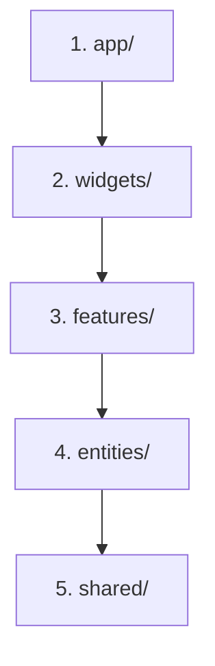

# CLAUDE.md - QSlate Frontend Engineering Standards & Code Conventions

> **Repository:** `QSlate-Front`  
> **Tech Stack:** Next.js 16 (App Router, Turbopack), React 19, TypeScript 5, Tailwind CSS v4, Zustand 5, TanStack Query 5, Vitest 3, Lightweight Charts, Monaco Editor.  
> **Role:** Engineering guide, code style manual, and contributing standard for AI agents and human developers. Every line of code written in this repository MUST comply with these standards.

---

## 1. Guiding Principles & Code Quality Bar

1. **Institutional Grade & Clean Code:** QSlate is a high-performance quantitative finance laboratory. Code must be robust, maintainable, performant, and self-documenting. No sloppy hacks, no lingering debug code, no unused variables.
2. **Strict Type Safety:** Zero tolerance for `any`. All props, functions, API payloads, state objects, and callbacks must be explicitly and strictly typed.
3. **Downward Layer Dependency:** Strictly adhere to Feature-Sliced Design (FSD). A layer can only import from layers below it. No circular imports.
4. **Clean Git History:** Every commit must be atomic, bisectable, and strictly follow Conventional Commits.

---

## 2. Architecture: Feature-Sliced Design (FSD)

All application code resides in `src/`. The directory structure follows strict domain-driven Feature-Sliced Design:

```text
src/
├── app/          # Next.js App Router (routes, layouts, providers, middleware). No complex UI logic.
├── widgets/      # Self-contained composite UI sections (e.g., MiniIDE, DynamicGrid, LabSidebar).
├── features/     # User interactions and business actions (e.g., user-auth, run-backtest, theme-sync).
├── entities/     # Domain models, TypeScript interfaces, and entity stores (e.g., user, widget, backtest).
└── shared/       # Agnostic foundational primitives: ui/, api/, theme/, lib/.
```

### Hierarchy & Import Rules



- **Rule 1 (Downward Flow):** A layer may only import from layers located **below** it.
  - `widgets` can import from `features`, `entities`, and `shared`.
  - `features` can import from `entities` and `shared`.
  - `entities` can only import from `shared`.
  - `shared` NEVER imports from upper layers (`entities`, `features`, `widgets`, `app`).
- **Rule 2 (Public API Boundary):** Cross-slice imports must always pass through the slice's public API barrel file (`index.ts`). Never import internal deep paths like `import { x } from '@/features/user-auth/ui/LoginForm'`; use `import { LoginForm } from '@/features/user-auth'`.
- **Rule 3 (Isolation):** Slices on the same layer must not import each other directly (e.g. `features/user-auth` must not import from `features/lab-state`). Coordinate via `widgets` or global stores in `entities`.

---

## 3. Next.js 16 & React 19 Standards

### Server vs. Client Components

1. **Default to Server Components (RSC):** Layouts, pages, static visual scaffolding, and initial data fetching must remain Server Components.
2. **Minimal Client Boundaries:** Push `'use client'` to the leaves of the component tree. Only mark a component as a client component when it requires:
   - React state hooks (`useState`, `useReducer`, `useRef`).
   - Effects or DOM listeners (`useEffect`, `useLayoutEffect`).
   - Browser APIs (`window`, `document`, `EventSource`, `localStorage`).
   - Client stores (`useLabStore`, `useAuthStore`, `useLayoutStore`).
3. **Dynamic Imports (`ssr: false`):** Heavy or browser-exclusive libraries (such as `@monaco-editor/react`, `lightweight-charts`, `three`, `@react-three/fiber`) **MUST** be loaded dynamically with `next/dynamic` and `ssr: false` to prevent SSR hydration crashes.
4. **Hydration Safety:** Never access `window` or `localStorage` during initial server render. Use `useHydratedStore` or `useEffect` mount guards when rendering client-stored preferences to prevent hydration mismatches.

### Component Design & Clean Code Rules

- **Function Declarations:** Prefer explicit named function exports for components:
  ```tsx
  export function MiniIdeView({ strategyId }: MiniIdeViewProps) { ... }
  ```
- **Props Typing:** Define a dedicated interface for component props immediately above the component:
  ```tsx
  interface MetricCardProps {
    readonly title: string;
    readonly value: number;
    readonly unit?: string;
    readonly variant?: 'positive' | 'negative' | 'neutral';
  }
  ```
- **Readonly Data:** Mark props and immutable arrays as `readonly` to prevent accidental state mutation.
- **Hook Cleanup:** Always return a cleanup function in `useEffect` for timers, subscriptions, WebSocket connections, or chart instances:
  ```tsx
  useEffect(() => {
    const handleResize = () => { ... };
    window.addEventListener('resize', handleResize);
    return () => window.removeEventListener('resize', handleResize);
  }, []);
  ```
- **No Inline Styles:** Use Tailwind utility classes. Do not use inline `style={{ ... }}` unless calculating dynamic coordinate positions for canvas/drag-and-drop grids that cannot be expressed via CSS.

---

## 4. TypeScript Guidelines

- **Compiler Config:** The repository runs with strict TypeScript 5. `noImplicitAny`, `strictNullChecks`, `strictFunctionTypes`, and `noUnusedLocals` are strictly enforced.
- **No `any`:** Under no circumstances should `any` be introduced. Use `unknown` with narrowing/type predicates, generics, or precise union types.
- **Discriminated Unions for States:**
  ```tsx
  type AsyncStatus<T> =
    | { status: 'idle'; data: null; error: null }
    | { status: 'loading'; data: null; error: null }
    | { status: 'success'; data: T; error: null }
    | { status: 'error'; data: null; error: ApiError };
  ```
- **Type Casting:** Avoid type assertions (`as Type`) whenever possible. If unavoidable, validate at runtime with type guards.
- **Naming Conventions:**
  - `PascalCase` for Components, Types, Interfaces, Enums.
  - `camelCase` for functions, variables, hook names (`useAuthStore`), methods.
  - `SCREAMING_SNAKE_CASE` for global constants (`MOCK_STRATEGIES`, `DEFAULT_LAYOUT`).
  - `kebab-case` for directory names, file names (`mini-ide`, `client.ts`, `use-hydrated-store.ts`).

---

## 5. Styling, Theming & Accessibility (WCAG 2.1 AA)

### Design System & Tailwind v4

- **Matte Dark Aesthetic:** QSlate uses an ultra-clean matte dark theme (`#050505` root background, `#0c0d0e` cards, `#242528` borders).
- **Light Theme Support:** High-contrast zinc palette (`bg-white`, `border-zinc-200`, `text-zinc-900`).
- **Typography:**
  - `JetBrains Mono` (`font-mono`) is **mandatory** for all financial figures, tabular data, order books, code editors, and timestamps.
  - System sans-serif (`font-sans`) for headings, marketing prose, and descriptive labels.

### Accessibility (a11y) & Daltonism Mode

- **Daltonism (Color-Blindness) Support:**
  - QSlate includes a native `orange-blue` mode alongside `none` (red-green).
  - Profit/positive return: Emerald green (`#10B981`) or Cyan/Blue (`#38BDF8`).
  - Loss/negative return: Rose red (`#F43F5E`) or Amber/Orange (`#F97316`).
  - **Cardinal Rule:** NEVER rely solely on color to convey state or direction. Always pair colored values with directional indicators (e.g., `+`, `-`, `▲`, `▼`, `TrendingUp`, `TrendingDown`).
- **Keyboard Navigation:** Every interactive button, tab, drawer toggle, and modal MUST be operable via keyboard (`Enter`, `Space`, `Escape`). Use `:focus-visible` ring outlines.
- **Canvas Charts Fallback:** Canvas-based financial charts (Lightweight Charts) must include visually hidden semantic HTML `<table>` elements with ARIA landmarks (`role="region"`, `aria-label`) for screen readers.

---

## 6. State Management & API Integration

### Client State: Zustand

- Create dedicated slices under `src/entities/*/model/` or `src/features/*/model/`.
- Use atomic selectors to prevent unnecessary re-renders:
  ```tsx
  // ✅ GOOD: Re-renders only when user changes
  const user = useAuthStore((state) => state.session);

  // ❌ BAD: Re-renders on any store change
  const { session, login, logout } = useAuthStore();
  ```

### Server State: TanStack Query (React Query)

- Use for asynchronous server queries, polling, and mutations.
- Keep query keys standardized and colocated with the entity:
  ```tsx
  export const strategyKeys = {
    all: ['strategies'] as const,
    list: () => [...strategyKeys.all, 'list'] as const,
    detail: (id: string) => [...strategyKeys.all, 'detail', id] as const,
    versions: (id: string) => [...strategyKeys.detail(id), 'versions'] as const,
  };
  ```

### API Client (`src/shared/api/client.ts`)

- All HTTP calls route to the Go Gateway (`/qslate/v1/*`, default port `8080`).
- Handle errors via `ApiError` (`statusCode`, `code`, `message`).
- Authentication:
  - Access token stored in memory (`tokenProvider`).
  - Refresh token handled via `HttpOnly`, `SameSite=Lax` cookie with `credentials: 'include'`.
  - When communicating with backend endpoints that require session cookies, `credentials: 'include'` must be sent.

---

## 7. Testing Standards (Vitest & React Testing Library)

- **Test File Colocation:** Test files are colocated inside `__tests__/` directories adjacent to the code they verify (e.g., `src/features/user-auth/__tests__/LoginForm.test.tsx`).
- **Required Coverage:**
  - Every API client method must have unit tests covering success, 4xx, 5xx, and network error handling.
  - Form components must test client validation, disabled state during submission, error banner display, and successful submit callback.
  - Stores must test initial state, state transitions, reset actions, and persistence hydration.
- **Testing Library Best Practices:**
  - Query by accessible roles and labels (`getByRole('button', { name: /save/i })`, `getByLabelText`).
  - Avoid querying by class names or test IDs unless no accessible role exists.
  - Clean up mocks after every test suite: `vi.clearAllMocks()`.

---

## 8. Git & Conventional Commit Standards

To maintain a pristine, bisectable, and automated changelog history, all commits must adhere to the following strict conventions:

### Commit Format

```text
<type>(<scope>): <short description in imperative mood>

[optional body explaining motivation and details]

[optional footer: Closes #123, Refs #456]
```

### Commit Types

- `feat`: A new feature or user-facing functionality.
- `fix`: A bug fix.
- `docs`: Documentation changes only (e.g., `CLAUDE.md`, `README.md`).
- `style`: Changes that do not affect code logic (formatting, whitespace, semi-colons).
- `refactor`: Code refactoring without adding features or fixing bugs.
- `perf`: Performance improvement (e.g., bundle size reduction, memoization).
- `test`: Adding or updating tests.
- `build`: Build system, bundling, or external dependency changes.
- `ci`: CI/CD pipeline or GitHub Actions workflow changes.
- `chore`: Maintenance tasks, husky hooks, tooling configuration.
- `revert`: Reverting a previous commit.

### Allowed Scopes

- `lab`: The core Lab workspace, dynamic grid, toolbar, shell.
- `ide`: Mini IDE, Monaco editor wrapper, linting, code runner.
- `marketplace`: Marketplace catalog, modules, reviews, install flow.
- `auth`: Login, register, session management, route guards.
- `settings`: Simulation settings, API keys, user preferences.
- `charts`: Lightweight charts, TradingView candlestick feeds.
- `widgets`: Dynamic widget instances, add-widget drawer.
- `api`: HTTP client, backend integration, DTO definitions.
- `state`: Zustand stores, global context, hydration.
- `theme`: Appearance provider, dark/light themes, daltonism mode.
- `a11y`: Accessibility improvements, screen readers, keyboard nav.
- `security`: CSP headers, input sanitization, token handling.
- `deps`: Dependency upgrades or package.json changes.

### Commit Rules & Checklist

1. **Imperative, lower-case subject:** Use `feat(ide): connect linting diagnostics` (NOT `Added linting` or `feat(ide): Connects linting.`).
2. **No trailing period** in the subject line.
3. **Atomic commits:** One feature or logical fix per commit. Do not combine auth fixes with chart styling changes.
4. **Pre-commit hooks:** Husky will automatically run `lint-staged` (ESLint + Prettier) and `commitlint`. Never bypass hooks with `--no-verify`.

### Branch Naming Convention

```text
<issue-number>-<short-description-in-kebab-case>
```

_Examples:_

- `118-connect-mini-ide-to-strategy-service`
- `119-connect-marketplace-views-to-backend-catalog`
- `120-connect-add-widget-drawer-to-widget-catalog`
- `121-sync-user-preferences-and-runner-api-keys`

---

## 9. Quality Gates & Validation Commands

Always run these commands before submitting changes or creating a Pull Request:

```bash
# 1. Run all unit and integration tests
npm test

# 2. Run ESLint (enforces import sorting and Next.js vitals)
npm run lint

# 3. Type-check TypeScript codebase without emitting JS
npx tsc --noEmit

# 4. Check formatting across files
npx prettier --check .

# 5. Verify production Next.js build
npm run build
```

Every PR must pass all five checks with zero warnings or errors.
