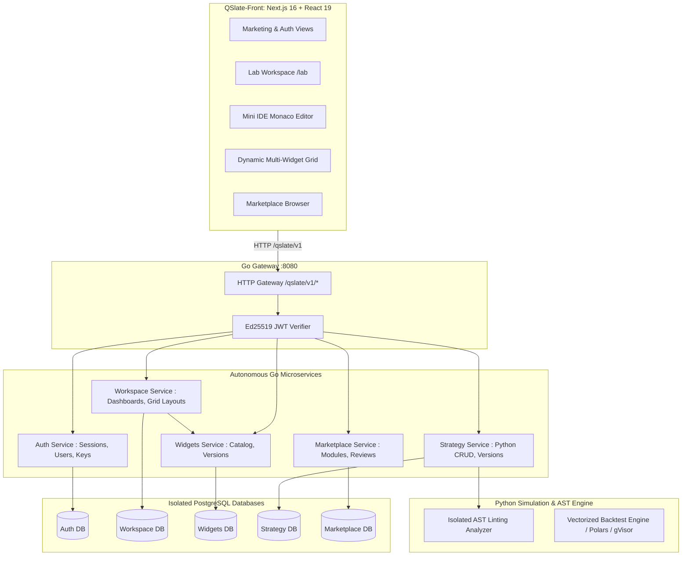

# LLMS.md - QSlate AI Developer & Agent Onboarding Guide

> **Welcome, AI Agent / LLM Developer.**  
> This document is designed to give you instant, complete situational awareness of the **QSlate** ecosystem. It details the product vision, architecture, backend API contracts, and an actionable playbook to pick up and execute tickets immediately with zero human hand-holding.

---

## 1. Executive Summary & Project Context

### What is QSlate?

QSlate (originally codenamed _QuantForge_) is an institutional-grade **"Flight Simulator" for Quantitative Finance**, developed as an Epitech Innovative Project (EIP).

### The Problem: The "Missing Middle"

In algorithmic trading and quantitative finance, there is a painful bifurcation:

- **Retail Tools (TradingView, MetaTrader):** Highly accessible visual user interfaces, but lack institutional execution horsepower, vectorization, isolated execution sandboxes, and deep microstructure modeling.
- **Institutional Platforms (QuantConnect, Bloomberg, in-house hedge fund infrastructure):** Immense computational power, but accompanied by steep learning curves, clunky or dated developer experiences, closed ecosystems, and cumbersome deployment.

**QSlate bridges this gap.** It combines the accessibility of a modern, responsive web application with a compiled, isolated quantitative execution engine and modular microservices.

### Target Personas

1. **The Quantitative Analyst ("The Coder"):** Writes algorithmic strategies and custom indicators in Python, tests against clean OHLCV historical data, runs high-iteration Monte Carlo simulations, and requires live AST linting and version control.
2. **The Retail Trader / Portfolio Manager ("The Visualizer"):** Wants a customizable drag-and-drop workspace, visual performance metrics (Sharpe, Sortino, Drawdown, Calmar), interactive Lightweight Charts, and the ability to install proven community strategies from a marketplace without writing code.

---

## 2. Global Architecture & Ecosystem Map

The QSlate platform consists of multiple coordinated components:



### Key Technical Characteristics of Backend Services

- **Autonomous Go Services:** Each microservice has its own `go.mod`, `Dockerfile`, database migrations, and isolated platform layer. No shared database tables or cross-service SQL joins.
- **Ed25519 Asymmetric JWTs:** The Auth service signs access tokens using an Ed25519 private key. The Gateway and services verify tokens using the corresponding public key. Access tokens have a 15-minute TTL.
- **Secure Refresh Cookie:** Long-lived sessions (up to 30 days) use an opaque, rotating refresh token stored in an `HttpOnly`, `SameSite=Lax`, `Path=/qslate/v1/auth` cookie.
- **Resource Ownership:** The Gateway checks authentication; individual domain services enforce strict resource ownership (a valid token only accesses resources owned by that `user_id`).

---

## 3. Frontend Architecture (Feature-Sliced Design)

The `QSlate-Front` codebase strictly adheres to **Feature-Sliced Design (FSD)**:

```text
src/
├── app/                  # Routing & Shell
│   ├── (marketing)/      # Landing page with 3D Canvas and marketing bento
│   ├── (auth)/           # /login, /register, and authentication layout
│   ├── lab/              # /lab, /lab/ide, /lab/marketplace, /lab/runs, /lab/settings
│   └── middleware.ts     # Route guard protecting /lab routes
├── widgets/              # Composite UI Units
│   ├── dynamic-grid/     # Multi-widget drag-and-drop workspace (react-grid-layout)
│   ├── mini-ide/         # Embedded Monaco Python IDE with split view and diagnostics
│   ├── marketplace/      # Community strategy & indicator store
│   ├── add-widget-drawer/# Drawer to add/remove widgets from active dashboard
│   ├── lab-sidebar/      # Navigation, active profile display, logout flow
│   ├── lab-toolbar/      # Strategy selection, dates, timeframe, "Run Backtest"
│   ├── backtest-results/ # Financial metrics, equity curve, drawdown, trade log
│   └── settings-view/    # Simulation friction, gVisor limits, compliance notices
├── features/             # User Interactions & Use Cases
│   ├── user-auth/        # LoginForm, RegisterForm, PasswordStrengthMeter
│   ├── lab-state/        # Central Lab workspace state (useLabStore)
│   ├── run-backtest/     # Backtest execution trigger and provider
│   ├── theme-sync/       # Appearance synchronization (theme, daltonism)
│   └── customize-lab/    # Widget picker actions
├── entities/             # Domain Models & Stores
│   ├── user/             # useAuthStore, session cookies, user types
│   ├── layout/           # useLayoutStore, grid coordinates, local storage persistence
│   ├── widget/           # Widget inventories and module types
│   ├── strategy/         # Strategy models, mock templates, versions
│   ├── backtest/         # Simulation results, financial calculation models
│   └── market/           # OHLCV candles, ticker configs
└── shared/               # Foundational Utilities
    ├── api/              # QslateApiClient, types, websocket client
    ├── theme/            # AppearanceProvider, theme types
    ├── ui/               # Reusable UI components (Spotlight, Toast, Dialog, Charts)
    └── lib/              # Hydrated store helpers
```

---

## 4. Backend API Contract & Integration Reference

All requests route through `http://localhost:8080/qslate/v1/*` (or `process.env.NEXT_PUBLIC_API_URL`).

### 1. Authentication & Users Domain

| Method   | Endpoint                  | Description                | Payload / Response                                                                                                         |
| :------- | :------------------------ | :------------------------- | :------------------------------------------------------------------------------------------------------------------------- |
| `POST`   | `/auth/register`          | Register new user account  | In: `{ email, username, password }`<br>Out: `AuthSession`                                                                  |
| `POST`   | `/auth/login`             | Login with credentials     | In: `{ identifier, password }`<br>Out: `AuthSession`                                                                       |
| `POST`   | `/auth/logout`            | Revoke active session      | Clears session cookie                                                                                                      |
| `POST`   | `/auth/refresh`           | Rotate access token        | Uses `HttpOnly` refresh cookie; returns new `AuthSession`                                                                  |
| `GET`    | `/users/me`               | Fetch active user profile  | Header: `Authorization: Bearer <token>`<br>Out: `{ user: User }`                                                           |
| `GET`    | `/users/me/preferences`   | Get user preferences       | Out: `{ theme: 'dark'\|'light', colorblind_mode: 'none'\|'orange-blue' }`                                                  |
| `PATCH`  | `/users/me/preferences`   | Update display preferences | In: `{ theme?: string, colorblind_mode?: string }`                                                                         |
| `GET`    | `/users/me/api-keys`      | List user runner API keys  | Out: `{ items: ApiKeySummary[] }`                                                                                          |
| `POST`   | `/users/me/api-keys`      | Create runner API key      | In: `{ name: string, scopes: string[], expires_in_days?: number }`<br>Out: `{ key: ApiKeyWithSecret }` (secret shown once) |
| `DELETE` | `/users/me/api-keys/{id}` | Revoke runner API key      | Status `204 No Content`                                                                                                    |

### 2. Strategy Domain (`/qslate/v1/strategies`)

| Method | Endpoint                    | Description                  | Payload / Notes                                                                                                          |
| :----- | :-------------------------- | :--------------------------- | :----------------------------------------------------------------------------------------------------------------------- |
| `POST` | `/strategies/lint`          | Static Python AST analysis   | In: `{ source: string }`<br>Out: `{ valid: boolean, errors?: Array<{ line: number, column: number, message: string }> }` |
| `GET`  | `/strategies`               | List user strategies         | Query: `?limit=20&cursor=...`<br>Out: `{ items: StrategySummary[] }`                                                     |
| `POST` | `/strategies`               | Create new strategy draft    | In: `{ name: string, source: string, parameters?: object }`                                                              |
| `GET`  | `/strategies/{id}`          | Get strategy with source     | Out: `StrategyDetail` (includes latest source & version ID)                                                              |
| `PUT`  | `/strategies/{id}`          | Commit new strategy revision | In: `{ base_version_id: string, source: string, parameters?: object }`<br>Returns 409 on version conflict.               |
| `GET`  | `/strategies/{id}/versions` | List revision history        | Out: `{ items: StrategyVersion[] }`                                                                                      |
| `POST` | `/strategies/{id}/restore`  | Restore previous revision    | In: `{ current_version_id: string, target_version_id: string }`                                                          |
| `POST` | `/strategies/import`        | Upload external `.py` file   | Multipart form with single `.py` file (max 100KB UTF-8)                                                                  |

### 3. Widgets & Workspace Domain

| Method | Endpoint                           | Description            | Payload / Notes                                                                                      |
| :----- | :--------------------------------- | :--------------------- | :--------------------------------------------------------------------------------------------------- |
| `GET`  | `/widgets/installed`               | List available widgets | Returns globally available + private widgets                                                         |
| `GET`  | `/widgets`                         | Full widget catalog    | Versioned widget definitions                                                                         |
| `GET`  | `/workspaces/dashboards/default`   | Fetch user dashboard   | Returns active layout coordinates, widgets, revision                                                 |
| `PUT`  | `/workspaces/dashboards/{id}/grid` | Save grid layout       | In: `{ revision: number, positions: WidgetPosition[] }`<br>Optimistic concurrency (409 on conflict). |

### 4. Marketplace Domain (`/qslate/v1/marketplace`)

| Method   | Endpoint                            | Description            | Payload / Notes                                     |
| :------- | :---------------------------------- | :--------------------- | :-------------------------------------------------- |
| `GET`    | `/marketplace/items`                | Search community items | Public. Query: `?search=...&category=...&limit=...` |
| `GET`    | `/marketplace/items/{id}`           | Item details & stats   | Public. Details, rating, author, installs.          |
| `POST`   | `/marketplace/items/{id}/install`   | Install module         | Authenticated. Installs snapshot to user account.   |
| `DELETE` | `/marketplace/items/{id}/uninstall` | Uninstall module       | Authenticated. Removes installation.                |
| `POST`   | `/marketplace/items/{id}/reviews`   | Post rating and review | In: `{ rating: number (1-5), comment: string }`     |

---

## 5. Step-by-Step Ticket Execution Playbook for LLMs

When picking up a GitHub Issue or ticket, execute these steps in strict sequence:

### Step 1: Issue Analysis & Verification

1. Inspect the issue description and acceptance criteria:
   ```bash
   gh issue view <issue-id> --repo QSlate/QSlate-Front
   ```
2. Note the target milestone, labels, acceptance criteria, and affected layers.

### Step 2: Branch Creation

1. Ensure your local `main` branch is clean and up to date:
   ```bash
   git checkout main && git pull origin main
   ```
2. Create your feature branch following the naming convention:
   ```bash
   git checkout -b <issue-id>-<kebab-case-description>
   ```

### Step 3: Architecture Planning (FSD Check)

Determine where each new component, store, or method belongs:

- **API client calls:** Add typed methods to `src/shared/api/client.ts` or a domain-specific module in `src/shared/api/`. Define request/response DTOs in `src/shared/api/types.ts`.
- **Domain logic & entity stores:** Place in `src/entities/<domain>/model/`.
- **Interactive UI components:** Place in `src/widgets/<widget-name>/ui/` or `src/features/<feature-name>/ui/`.
- **Public exports:** Update `index.ts` barrel files to expose public interfaces.

### Step 4: Implementation

- Follow all standards in `CLAUDE.md`.
- Keep components typed, modular, and accessible.
- Support both `dark` and `light` themes, and test `orange-blue` colorblind mode.
- Avoid introducing `any` or disabling lint rules.

### Step 5: Test Automation

Write unit and integration tests under `__tests__/`:

- Use Vitest and React Testing Library.
- Test loading states, error states, user interactions, and successful API responses.
- Ensure all tests pass:
  ```bash
  npm test
  ```

### Step 6: Code Quality Gates

Run all verification scripts. Every single one must pass cleanly:

```bash
# 1. Vitest suite
npm test

# 2. ESLint
npm run lint

# 3. Strict TypeScript compilation
npx tsc --noEmit

# 4. Next.js production build
npm run build
```

### Step 7: Clean Atomic Commits

Commit changes following Conventional Commits:

```bash
git add <specific files>
git commit -m "feat(<scope>): <imperative subject>"
```

_Example:_

```bash
git commit -m "feat(ide): connect Monaco editor to Go strategy linting endpoint"
```

### Step 8: Push & Open Pull Request

Push the branch and create a GitHub Pull Request:

```bash
git push -u origin <branch-name>
gh pr create --title "feat(<scope>): <description>" --body "Closes #<issue-id>..."
```

---

## 6. Immediate Active Tickets: Front-to-Back Integration

Here are the four prioritized front-to-back connection tickets currently queued:

### Ticket #118: Connect Mini IDE to Strategy Service

- **Goal:** Replace mock IDE state with Go Strategy backend endpoints.
- **Key Tasks:**
  - Add API methods in `QslateApiClient`: `lintStrategy(source)`, `getStrategies()`, `getStrategy(id)`, `saveStrategyVersion(id, payload)`, `restoreStrategyVersion(id, payload)`, `importStrategy(file)`.
  - Connect Monaco editor in `src/widgets/mini-ide/ui/MonacoEditorWrapper.tsx` to debounce (300ms) calls to `POST /qslate/v1/strategies/lint` and set `monaco.editor.setModelMarkers`.
  - Add a Version History drawer/dropdown in the Mini IDE toolbar.
  - Implement the "Import Strategy" `.py` file upload flow.

### Ticket #119: Connect Marketplace Views to Go Backend Catalog API

- **Goal:** Replace static `MARKETPLACE_MODULES` with live Go Marketplace API data.
- **Key Tasks:**
  - Add API methods: `getMarketplaceItems(params)`, `getMarketplaceItem(id)`, `installMarketplaceItem(id)`, `uninstallMarketplaceItem(id)`.
  - Update `src/widgets/marketplace/ui/MarketplaceView.tsx` to consume live queries with TanStack Query.
  - Connect the Install / Uninstall button to persist state on the backend.

### Ticket #120: Connect Add-Widget Drawer to Widget Catalog API

- **Goal:** Connect `src/widgets/add-widget-drawer/` to the Go Widgets service (`GET /qslate/v1/widgets/installed`).
- **Key Tasks:**
  - Fetch user installed widgets and global widget inventory from backend.
  - Synchronize widget active status and allow dynamic instantiation.

### Ticket #121: Synchronize User Display Preferences & Runner API Keys

- **Goal:** Persist theme and daltonism settings and connect API key management in Settings.
- **Key Tasks:**
  - Add API methods: `getPreferences()`, `updatePreferences(payload)`, `getApiKeys()`, `createApiKey(payload)`, `deleteApiKey(id)`.
  - Sync `AppearanceProvider` changes to `PATCH /qslate/v1/users/me/preferences` with debounce.
  - Build the Runner API Keys management card in `src/widgets/settings-view/ui/SettingsView.tsx` with copy-to-clipboard modal.

---

## 7. Useful Diagnostic & Development Commands

```bash
# Start local Next.js development server
npm run dev

# Start backend Go microservices and databases (from QSlate-Back)
cd ../QSlate-Back && make up

# Check backend health
curl http://localhost:8080/readyz

# Inspect GitHub issues
gh issue list --repo QSlate/QSlate-Front

# Inspect GitHub issue details
gh issue view <issue-id> --repo QSlate/QSlate-Front
```
